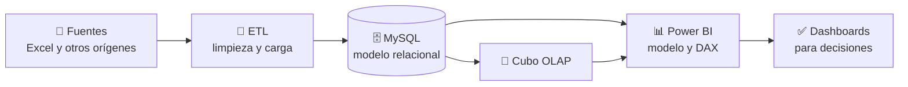

<p align="center">
  
</p>

<h1 align="center">Business Intelligence & Analytics</h1>

<p align="center">
  <i>From scattered data to decisions.</i>
</p>

<p align="center">
  
  
  
  
  
  
</p>

<p align="center">
  <a href="#problem">Problem</a> &nbsp;·&nbsp;
  <a href="#solution">Solution</a> &nbsp;·&nbsp;
  <a href="#architecture">Architecture</a> &nbsp;·&nbsp;
  <a href="#dashboards">Dashboards</a> &nbsp;·&nbsp;
  <a href="#data-model">Data model</a> &nbsp;·&nbsp;
  <a href="#contact">Contact</a>
</p>

---

<a id="problem"></a>
## 🎯 Problem

> Data lived in several sources with **no single view** to support decisions.

- Reports were consolidated **by hand**, from spreadsheets.
- The same indicator could show **different numbers** depending on the report.
- Decisions waited on information that was already outdated.

<a id="solution"></a>
## 🛠️ Solution

Build a single, reliable path from the sources to the dashboards:

| Layer | Tool | What it does |
|---|---|---|
| 🗄️ **Storage** | MySQL | Relational database that holds the consolidated data |
| 🔄 **Integration** | ETL | Extracts, transforms and loads the sources into the model |
| 🧊 **Analysis** | OLAP cube | Multidimensional model for fast analysis by period, category and other dimensions |
| 📊 **Visualization** | Power BI | Interactive dashboards with DAX measures for the KPIs |

<a id="architecture"></a>
## 🏗️ Architecture



**Why this order?** The relational model keeps the source of truth. The cube and the dashboards are built on top of it, so every view reads from the same data.

<a id="outcome"></a>
## ✅ Outcome

- ✔️ **One documented data model** used as the single source of truth.
- ✔️ **Consistent numbers** across reports, because KPIs are defined once.
- ✔️ **Dashboards ready for decisions**, with slicers and drill-down.

<a id="dashboards"></a>
## 📊 Dashboards

<p align="center">
  
</p>

<details>
<summary><b>Ver más vistas</b></summary>

<p align="center">
  
</p>

</details>

<a id="data-model"></a>
## 🧩 Data model

The model follows a **star schema**: fact tables with measures, surrounded by dimensions that describe them.

| Table | Type | Role |
|---|---|---|
| `fact_*` | ⭐ Fact | Measures and transactions |
| `dim_*` | 🔷 Dimension | Context: date, product, customer and others |

## 📐 Key DAX measures

```dax
-- Ejemplo de medida: reemplázalo por las tuyas
Total Ventas = SUM ( Ventas[Monto] )
```

Measures are defined once in Power BI, so every page and visual uses the same logic.

## 📁 Project structure

```
Business_Intelligence_Analytics/
├── README.md
├── data/sample/          Datos ficticios para probar el proyecto
├── sql/
│   ├── 01_schema.sql     Tablas y relaciones
│   ├── 02_load.sql       Carga inicial
│   └── 03_views.sql      Vistas para el modelo de reporte
├── etl/                  Extracción y transformación
├── powerbi/
│   └── measures_dax.md   Medidas DAX documentadas
├── images/               Capturas del README
└── docs/
    └── data-model.md     Diagrama y definición de tablas
```

## 🚀 How to run it

1. Crea la base de datos y ejecuta `sql/01_schema.sql`.
2. Carga los datos de ejemplo con `sql/02_load.sql`.
3. Abre el archivo de Power BI y actualiza la conexión a tu servidor MySQL.

## 🧠 Design decisions

- **Relational first, then OLAP.** The schema keeps the source of truth; the cube speeds up analysis.
- **KPIs in DAX, not in the data.** One definition, reused everywhere.
- **Sample data only.** The repository contains no operational information.

<a id="contact"></a>
## 👤 Author

**Dani Gonzalez** · Data Analyst & Junior AI Engineer · Puebla, México

<p align="left">
  <a href="https://www.linkedin.com/in/victorgonzalezgopv/"></a>
  <a href="https://github.com/Danivinho1"></a>
</p>
