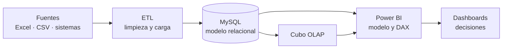

# Business Intelligence & Analytics

**MySQL · ETL · OLAP · Power BI · DAX · Excel**

End-to-end analytics project: from scattered data sources to a relational model, an automated ETL pipeline, an OLAP cube and interactive dashboards that support decisions.

> 📌 *Replace the `[COMPLETAR]` markers with your real dataset, KPIs and results before publishing.*

---

## 🎯 Problem

Data lived in several sources with no single view. Teams had to consolidate spreadsheets by hand, and the numbers did not always match between reports.

## 🛠️ Solution

| Layer | Tool | What it does |
|---|---|---|
| Storage | MySQL | Relational database with a documented schema |
| Integration | ETL pipeline `[COMPLETAR: Python / SQL / herramienta]` | Extracts, cleans and loads the sources into the model |
| Analysis | OLAP cube `[COMPLETAR: herramienta]` | Multidimensional model for fast slicing by period, product and region |
| Visualization | Power BI | Interactive dashboards with DAX measures for KPIs |



## ✅ Outcome

- One documented data model used as the single source of truth.
- Reports refreshed from the same pipeline, so the numbers match across views.
- `[COMPLETAR: resultado medible, por ejemplo: horas ahorradas por ciclo, número de reportes consolidados]`

---

## Dashboards

`[COMPLETAR: captura del dashboard principal]`


`[COMPLETAR: captura de la vista de detalle o de KPIs]`

## Project structure

```
Business_Intelligence_Analytics/
├── README.md
├── data/
│   └── sample/              Datos ficticios para probar el proyecto
├── sql/
│   ├── 01_schema.sql        Creación de tablas y relaciones
│   ├── 02_load.sql          Carga inicial
│   └── 03_views.sql         Vistas para el modelo de reporte
├── etl/                     `[COMPLETAR: scripts de extracción y transformación]`
├── olap/                    `[COMPLETAR: definición del cubo]`
├── powerbi/
│   ├── dashboard.pbix       `[COMPLETAR: subir solo si no contiene datos sensibles]`
│   └── measures_dax.md      Medidas DAX documentadas
└── docs/
    └── data-model.md        Diagrama y definición de tablas
```

> Ajusta esta estructura a los archivos reales del repositorio.

## Data model

`[COMPLETAR: describir las tablas principales, por ejemplo: hechos de ventas, dimensión de fecha, dimensión de producto, dimensión de cliente]`

| Table | Type | Description |
|---|---|---|
| `[COMPLETAR]` | Fact | `[COMPLETAR]` |
| `[COMPLETAR]` | Dimension | `[COMPLETAR]` |

## Key DAX measures

```dax
-- Ejemplo: reemplázalo con tus medidas reales
Total Ventas = SUM ( Ventas[Monto] )
```

`[COMPLETAR: lista de KPIs principales y qué pregunta de negocio responde cada uno]`

## How to run it

1. Crea la base de datos y ejecuta `sql/01_schema.sql`.
2. Carga los datos de ejemplo con `sql/02_load.sql`, o ejecuta el ETL `[COMPLETAR: comando]`.
3. Abre `powerbi/dashboard.pbix` y actualiza la conexión a tu servidor MySQL.

## Design decisions

- **Relational model first, then OLAP.** The relational schema keeps the source of truth; the cube is built on top for analysis speed.
- **Measures in DAX, not in the data.** KPIs are defined once in Power BI, so they stay consistent across pages.
- **Sample data only in the repository.** `[COMPLETAR: confirma que no se publica información real]`

## Limitations

- `[COMPLETAR: por ejemplo: la carga es manual / el ETL corre a demanda / el cubo se reconstruye completo]`

## Roadmap

- `[COMPLETAR: próximos pasos, por ejemplo: automatizar la carga programada, agregar nuevas fuentes]`

## Tech stack

`MySQL` · `SQL` · `Power BI` · `DAX` · `Excel` · `ETL` · `OLAP`

## Author

**Dani Gonzalez** · Data Analyst & Junior AI Engineer · Puebla, México
[LinkedIn](https://www.linkedin.com/in/victorgonzalezgopv/) · [GitHub](https://github.com/Danivinho1)

## License

`[COMPLETAR: MIT, u otra]`
